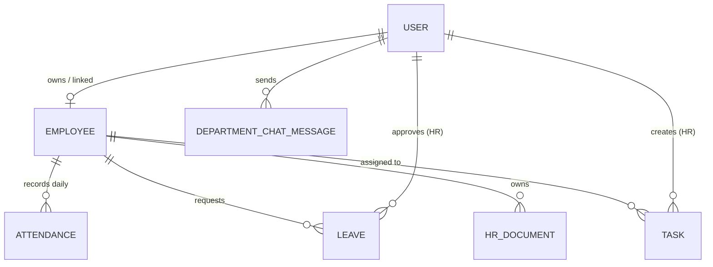

# LY SOFTWARE HR Backend - Database Models & Schema Design

## 1. Domain Entities & Database Schema

All models are built with **Mongoose 8** connecting to **MongoDB**.

---

## 2. Models Detail

### 1. `User` (`models/User.js`)
- `firstName`: String, required, trimmed
- `lastName`: String, required, trimmed
- `email`: String, required, unique, lowercase, trimmed
- `phone`: String, trimmed
- `password`: String, minlength 6, hashed with bcryptjs (`pre('save')`), hidden in serialization (`select: false`)
- `role`: Enum `['HR', 'STAFF', 'SUPER_ADMIN']`, required (SUPER_ADMIN has top-level administrative authority across HR management routes)
- `profileImage`: String
- `isActive`: Boolean, default true
- `lastLogin`: Date
- `refreshToken`: String, select false
- `resetPasswordToken`: String, select false
- `resetPasswordExpires`: Date, select false
- Timestamps: `createdAt`, `updatedAt`

### 2. `Employee` (`models/Employee.js`)
- `employeeId`: String, required, unique, uppercase, trimmed (e.g. `EMP1001`)
- `user`: ObjectId -> `User`, required, unique
- `firstName`: String, required
- `lastName`: String, required
- `email`: String, required, unique, lowercase
- `phone`: String
- `dateOfBirth`: Date
- `gender`: Enum `['MALE', 'FEMALE', 'OTHER']`
- `department`: String, required (e.g. `Tech`, `Telecalling`)
- `designation`: String, required
- `joiningDate`: Date, default `Date.now`
- `employmentType`: Enum `['FULL_TIME', 'PART_TIME', 'CONTRACT', 'INTERN']`
- `salary`: Number, min 0, default 0
- `salaryCurrency`: String, default 'INR'
- `salaryEffectiveDate`: String
- `paidLeaveAllowance`: Number, default 1
- `salaryHistory`: Array of subdocuments:
  - `amount`: Number, required
  - `currency`: String
  - `effectiveDate`: String
  - `changedBy`: String (HR user identifier)
  - `reason`: String
  - `timestamp`: String
- `address`, `city`, `state`, `country`: String
- `profileImage`: String
- `emergencyContact`: Object `{ name, relationship, phone }`
- `status`: Enum `['ACTIVE', 'INACTIVE', 'ON_LEAVE', 'TERMINATED']`
- Indexes: `{ department: 1 }`, `{ status: 1 }`, text index on name/email/department/designation.

### 3. `Attendance` (`models/Attendance.js`)
- `employee`: ObjectId -> `Employee`, required
- `date`: Date (normalized to midnight), required
- `checkIn`: Date
- `checkOut`: Date
- `status`: Enum `['PRESENT', 'ABSENT', 'HALF_DAY', 'LEAVE']`
- `workingHours`: Number, min 0
- `remarks`: String
- Compound Unique Index: `{ employee: 1, date: 1 }` (Prevents duplicate check-in sessions per day)

### 4. `Leave` (`models/Leave.js`)
- `employee`: ObjectId -> `Employee`, required
- `leaveType`: Enum `['CASUAL', 'SICK', 'ANNUAL', 'UNPAID', 'OTHER']`
- `startDate`: Date, required
- `endDate`: Date, required
- `reason`: String, required
- `status`: Enum `['PENDING', 'APPROVED', 'REJECTED', 'CANCELLED']`, default `PENDING`
- `approvedBy`: ObjectId -> `User`
- `approvedAt`: Date
- `rejectionReason`: String
- Indexes: `{ employee: 1, status: 1 }`, `{ startDate: 1, endDate: 1 }`

### 5. `HRDocument` (`models/HRDocument.js`)
- `employee`: ObjectId -> `Employee`, required
- `employeeIdString`: String
- `title`: String, required
- `category`: Enum `['Resume', 'Identity Proof', 'Educational Certificates', 'Offer Letter', 'Appointment Letter', 'Employment Agreement', 'Experience Certificate', 'Medical Certificate', 'Other']`
- `description`: String
- `fileName`: String, unique on filesystem
- `originalName`: String
- `filePath`: String
- `fileType`: String (MIME)
- `fileSize`: Number (Bytes)
- `issueDate`, `expiryDate`: String
- `uploadedBy`: String
- `uploadedByUserId`: ObjectId -> `User`
- `status`: Enum `['ACTIVE', 'ARCHIVED', 'REPLACED']`, default `ACTIVE`
- `version`: Number, default 1
- `history`: Array of audit actions `{ action, performedBy, timestamp, notes, previousFileName }`

### 6. `Task` (`models/Task.js`)
- `title`: String
- `description`: String, required
- `employee`: ObjectId -> `Employee`, required
- `department`: String, required
- `dueDate`: String, required
- `date`: String (creation date)
- `status`: Enum `['pending', 'in-progress', 'done', 'cancelled']`, default `pending`
- `createdBy`: ObjectId -> `User`
- `isDeleted`: Boolean, default false
- Indexes: `{ employee: 1, status: 1 }`, `{ department: 1 }`, `{ isDeleted: 1 }`

### 7. `DepartmentChatMessage` (`models/DepartmentChatMessage.js`)
- `departmentKey`: String, required (e.g. `tech`, `telecalling`)
- `senderId`: String, required
- `senderUser`: ObjectId -> `User`
- `senderEmployee`: ObjectId -> `Employee`
- `senderName`: String, required
- `receiverId`: String
- `text`: String, required (max 2000 chars)
- `timestamp`: Date, default `Date.now`
- `isRead`: Boolean, default false
- `deletedForEveryone`: Boolean, default false
- `deletedByIds`: Array of String (User IDs who clicked "Delete for Me")
- `deletedForEveryoneBy`: ObjectId -> `User`
- `deletedForEveryoneAt`: Date
- Indexes: `{ departmentKey: 1, timestamp: 1 }`, `{ senderId: 1 }`
